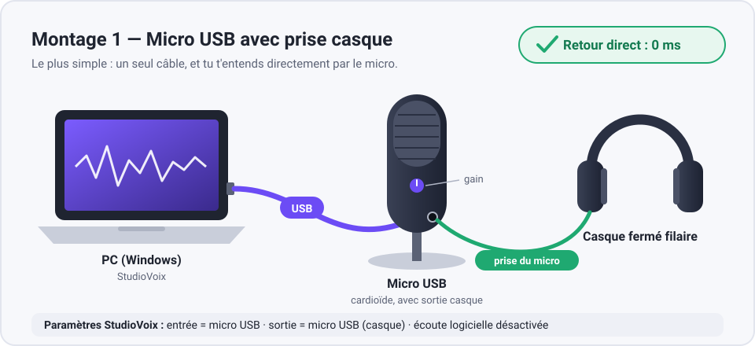
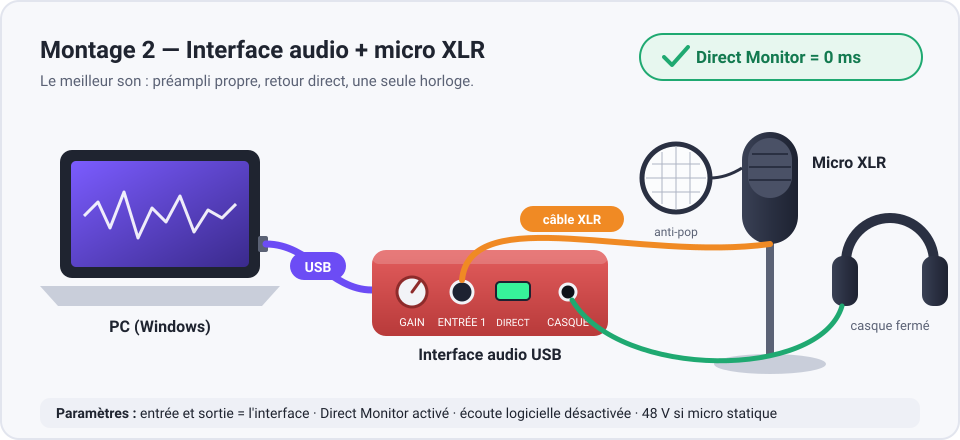
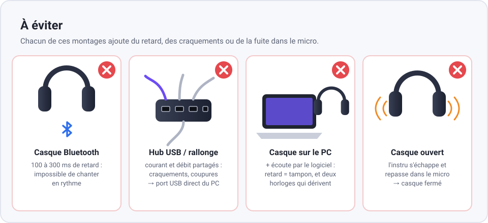
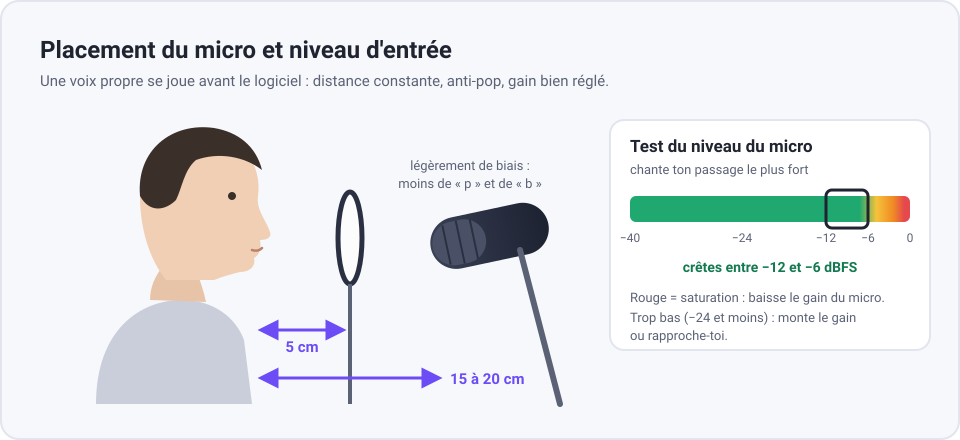

# Guide du matériel : micro, casque, branchements

StudioVoix fonctionne avec n'importe quel micro et n'importe quel casque : l'entrée et la sortie se
choisissent dans **Paramètres**. Ce guide explique quoi acheter et comment brancher pour avoir
**zéro retard dans le casque** et **la voix la plus propre possible**.

## L'essentiel en 4 règles

1. **Le casque se branche sur le micro USB ou sur l'interface audio**, pas sur le PC.
   Tu t'entends alors directement par le matériel (retour direct) : 0 ms de retard, quel que soit le PC.
2. **Casque fermé et filaire.** Jamais de Bluetooth pour enregistrer.
3. **Entrée et sortie sur le même appareil** dans les Paramètres (une seule horloge : pas de dérive).
4. **Port USB direct sur le PC**, sans hub ni rallonge.

StudioVoix recale ensuite chaque prise tout seul (latence de la carte son ou calibrage) : la voix
tombe pile sur l'instru même si l'enregistrement passe par un tampon.

## Montage 1 : micro USB avec prise casque

Le plus simple et le moins cher : un seul câble.

- **Choisir** un micro USB **cardioïde** avec **sortie casque** et **réglage de gain**.
  Exemples connus (à vérifier au moment de l'achat) : Samson Q2U, Audio-Technica ATR2100x-USB
  (dynamiques, USB + XLR : ils resteront utiles avec une interface plus tard).
- **Brancher** le micro sur un port USB du PC, le casque sur la prise du micro.
- Si le micro a un bouton **« mix »** (micro / ordinateur), le placer au milieu, puis ajuster à l'oreille.
- **Dans StudioVoix** : entrée = le micro, sortie = le micro (casque), écoute logicielle **désactivée**.

## Montage 2 : interface audio + micro XLR

Le meilleur son : préampli plus propre, gain plus précis, micro remplaçable.

- **Interface** 1 ou 2 entrées avec bouton **Direct Monitor** (ex. Focusrite Scarlett Solo / 2i2 ou
  équivalent).
- **Micro XLR** :
  - **dynamique** (ex. Shure SM58) : capte peu la pièce, idéal dans une chambre non traitée ;
  - **statique** (ex. Audio-Technica AT2020) : plus de détail, mais capte aussi la pièce ;
    il faut activer l'alimentation **48 V** (phantom) sur l'interface.
- **Brancher** : interface en USB sur le PC, micro en XLR sur l'entrée 1, casque sur la sortie casque.
- **Direct Monitor activé** ; si l'interface a un bouton de mélange (entrée / lecture), le régler à l'oreille.
- **Dans StudioVoix** : entrée et sortie = l'interface, écoute logicielle **désactivée**.

## Casque

- **Fermé** : le son de l'instru ne doit pas repasser dans le micro.
  Exemples connus : Audio-Technica ATH-M50x, Sony MDR-7506, Beyerdynamic DT 770 Pro.
- **Filaire** : le Bluetooth ajoute 100 à 300 ms de retard.
- Volume raisonnable : un casque trop fort finit aussi dans le micro sur les passages calmes.

## À éviter

- **Casque Bluetooth** : retard impossible à compenser à l'écoute.
- **Hub USB, rallonge, façade avant fatiguée** : coupures et craquements. Brancher à l'arrière du PC.
- **Casque sur la prise du PC + écoute par le logiciel** : on s'entend avec le retard du tampon, et
  deux horloges différentes (micro et PC) dérivent sur les longues prises.
- **Retour direct ET écoute logicielle en même temps** : ta voix arrive deux fois (effet d'écho).
  Garder seulement le retour direct.
- **Casque ouvert** : l'instru s'entend dans la prise de voix.

## Placement du micro et niveau

- **Anti-pop** à environ 5 cm du micro, **bouche à 15–20 cm** du micro, toujours la même distance.
- Micro **légèrement de biais** (10 à 15°) : moins de « p » et de « b » qui claquent.
- **Niveau** : dans Paramètres, bouton **« Test du niveau du micro (5 s) »**, chanter le passage le
  plus fort. Viser des crêtes **entre −12 et −6 dBFS**. Saturation = baisser le gain du micro
  (le gain matériel, pas le volume du logiciel). Le « gain numérique d'entrée » sert aux petits ajustements.
- **La pièce** : rideaux, canapé, lit, couvertures derrière toi ; éviter les murs nus et les coins.
  Couper ventilateur, clim, frigo proche. Téléphone en mode avion.

## Réglages Windows (une seule fois)

- **Son → Propriétés du micro → Avancé** :
  - cocher **« Autoriser les applications à prendre le contrôle exclusif de ce périphérique »** ;
  - format par défaut **48000 Hz** (la fréquence des projets StudioVoix : aucun rééchantillonnage).
  Faire de même pour la sortie casque.
- **Améliorations audio : désactivées** (micro et casque).
- **Alimentation** : mode « Performances optimales », PC portable **branché sur secteur** ;
  désactiver la **mise en veille sélective USB** dans les options d'alimentation avancées.
- Fermer les applications qui utilisent le micro (Discord, navigateur en visio…) avant d'enregistrer
  en mode exclusif.

## Réglages StudioVoix (une seule fois)

1. **Paramètres → carte son** : mode **Windows Audio (Exclusive Mode)**, entrée et sortie choisies,
   tampon **128** (monter à **256** si ça craque).
2. **Écoute logicielle désactivée** si le casque est sur le micro ou l'interface.
3. **Calibrer la latence** : casque posé contre le micro, volume moyen, cliquer ; 5 clics sont joués
   et mesurés. À refaire seulement si tu changes de matériel.
4. **Test du niveau du micro**.

## Dépannage rapide

| Problème | Solution |
|---|---|
| Craquements, coupures | Tampon 256, port USB arrière, secteur branché, fermer les applications lourdes |
| Voix en avance / en retard sur l'instru | Refaire le calibrage, puis ajuster le décalage manuel (± ms) |
| « Aucune carte son » ou périphérique occupé | Fermer l'appli qui utilise le micro, vérifier le contrôle exclusif, sinon mode « Windows Audio » |
| Écho dans le casque | Couper l'écoute logicielle (le retour direct suffit) |
| Instru audible dans la prise de voix | Casque fermé, volume du casque plus bas |
| Voix trop faible ou SATURATION | Test du niveau, régler le gain du micro / de l'interface |

Le journal `%APPDATA%\StudioVoix\logs\studiovoix_AAAAMMJJ.log` indique la carte, la fréquence,
le tampon et la latence utilisés : à joindre en cas de souci.
